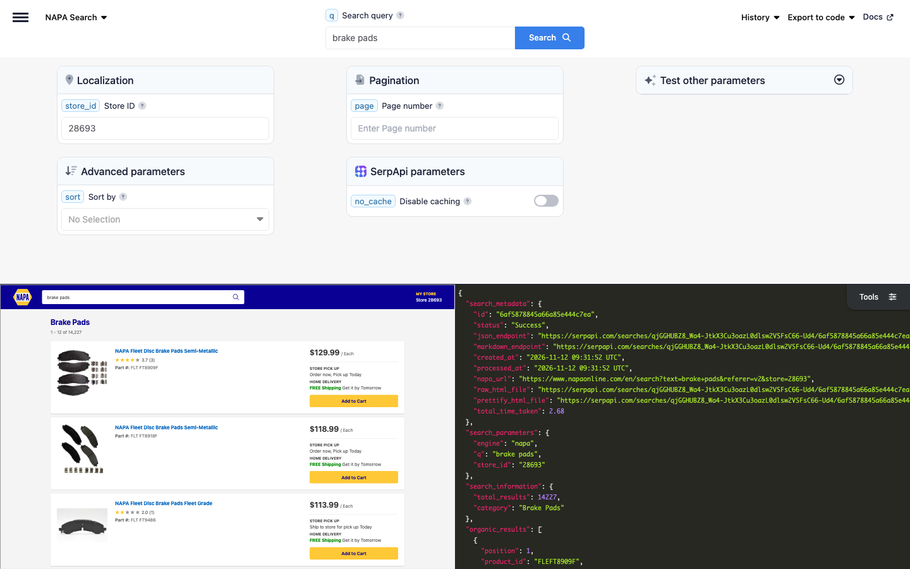

# NAPA Scraper

Scrape NAPA Auto Parts search results with SerpApi's NAPA Auto Parts Search API. Search parts by name, brand, or part number at any NAPA Auto Parts store, and get each product's title, link, brand, part number, thumbnail, rating, reviews, price at the store, price before a sale, promotions, and core deposit, and whether it can be picked up at the store or delivered, plus the category NAPA leads the search to.

## How to scrape NAPA Auto Parts search results

Search NAPA Auto Parts with a simple GET request:

```text
https://serpapi.com/search?engine=napa&q=brake+pads&api_key=SERPAPI_API_KEY
```

- `q` is the search query: anything you'd use in a regular NAPA Auto Parts search, such as a part, e.g., `brake pads`, a brand, e.g., `Brakleen`, or a part number, e.g., `CRC 05050`. Part numbers of other brands work too: `PH3614` returns the oil filters NAPA sells to replace it, e.g., NAPA Gold Oil Filter FIL 1348.
- `api_key` is your SerpApi API key. Replace `SERPAPI_API_KEY` with it.
- `store_id` sets the NAPA Auto Parts store by the number at the end of its store page URL on napaonline.com, e.g., `22706` for the store in Healdsburg, California. It defaults to `28693`, a store in Chicago, Illinois. Prices, promotions, availability, and the products listed depend on the store.
- `sort` sorts the products, e.g., by price, part number, or product line.
- `page` gets the next pages of results, with up to 12 products per page.

Prices are for the selected store. At the default store, many products that can't be delivered to your home have no price, e.g., Brakleen brake cleaners and motor oils, because NAPA doesn't return one for that store. Set `store_id` to another store to get them, e.g., `22706`, where CRC 05050 costs $5.89.

[Register at SerpApi](https://serpapi.com?utm_source=github_napa_scraper) to get your API key, and keep it private.

### Playground

Try the request live in the [SerpApi Playground](https://serpapi.com/playground?engine=napa&q=brake+pads&utm_source=github_napa_scraper).

[](https://serpapi.com/playground?engine=napa&q=brake+pads&utm_source=github_napa_scraper)

## Code examples

The code examples read your API key from the `SERPAPI_API_KEY` environment variable:

```bash
export SERPAPI_API_KEY="SERPAPI_API_KEY"
```

Each example searches NAPA Auto Parts for brake pads at the default store in Chicago, Illinois, and prints the part number, title, and price of each product on the first page.

### curl integration

Send the request with curl, which prints the full JSON response:

```bash
curl --get https://serpapi.com/search \
 --data-urlencode engine="napa" \
 --data-urlencode q="brake pads" \
 --data-urlencode api_key="$SERPAPI_API_KEY"
```

### JavaScript integration

Install the [SerpApi JavaScript library](https://github.com/serpapi/serpapi-javascript) and set your project to use ES modules:

```bash
npm install serpapi
npm pkg set type=module
```

Create an `index.js` file:

```javascript
import { getJson } from "serpapi";

const results = await getJson({
  engine: "napa",
  api_key: process.env.SERPAPI_API_KEY,
  q: "brake pads",
});

for (const product of results.organic_results ?? []) {
  console.log(product.part_number, product.title, product.price);
}
```

Run it with `node index.js`.

### Python integration

Install the [SerpApi Python library](https://github.com/serpapi/serpapi-python):

```bash
pip install serpapi
```

Create a `main.py` file:

```python
import os
import serpapi

client = serpapi.Client(api_key=os.getenv("SERPAPI_API_KEY"))
results = client.search({
    "engine": "napa",
    "q": "brake pads",
})

for product in results.get("organic_results", []):
    print(product["part_number"], product["title"], product.get("price"))
```

Run it with `python main.py`.

### Ruby integration

Install the [SerpApi Ruby library](https://github.com/serpapi/serpapi-ruby):

```bash
gem install serpapi
```

Create a `main.rb` file:

```ruby
require "serpapi"

client = SerpApi::Client.new(engine: "napa", api_key: ENV.fetch("SERPAPI_API_KEY"))
results = client.search(q: "brake pads")

results.fetch(:organic_results, []).each do |product|
  puts "#{product[:part_number]} #{product[:title]} #{product[:price]}"
end

client.close
```

Run it with `ruby main.rb`.

### PHP integration

Install the [SerpApi PHP library](https://github.com/serpapi/serpapi-php):

```bash
composer require serpapi/serpapi-php
```

Create an `index.php` file:

```php
<?php
require 'vendor/autoload.php';

use SerpApi\Client;

$client = new Client(getenv('SERPAPI_API_KEY'), 'napa');
$results = $client->search([
  'q' => 'brake pads',
]);

foreach ($results->organic_results ?? [] as $product) {
  echo $product->part_number . ' ' . $product->title . ' ' . ($product->price ?? '') . PHP_EOL;
}
```

Run it with `php index.php`.

### Go integration

Create a Go module and install the [SerpApi Go library](https://github.com/serpapi/serpapi-golang):

```bash
go mod init example.com/napa
go get github.com/serpapi/serpapi-golang
```

Create a `main.go` file:

```go
package main

import (
	"fmt"
	"os"

	"github.com/serpapi/serpapi-golang"
)

func main() {
	setting := serpapi.NewSerpApiClientSetting(os.Getenv("SERPAPI_API_KEY"))
	setting.Engine = "napa"
	client := serpapi.NewClient(setting)

	results, err := client.Search(map[string]string{
		"q": "brake pads",
	})
	if err != nil {
		panic(err)
	}

	organicResults, _ := results["organic_results"].([]interface{})
	for _, item := range organicResults {
		product := item.(map[string]interface{})
		fmt.Println(product["part_number"], product["title"], product["price"])
	}
}
```

Run it with `go run .`.

### Rust integration

Create a Cargo project and add the [SerpApi Rust library](https://github.com/serpapi/serpapi-rust) and Tokio:

```bash
cargo new napa && cd napa
cargo add serpapi tokio --features tokio/full
```

Replace `src/main.rs` with:

```rust
use serpapi::serpapi::Client;
use std::collections::HashMap;
use std::env;

#[tokio::main]
async fn main() -> Result<(), Box<dyn std::error::Error>> {
    let mut default = HashMap::new();
    default.insert("api_key".to_string(), env::var("SERPAPI_API_KEY")?);
    default.insert("engine".to_string(), "napa".to_string());
    let client = Client::new(default)?;

    let mut parameter = HashMap::new();
    parameter.insert("q".to_string(), "brake pads".to_string());

    let results = client.search(parameter).await?;
    if let Some(organic_results) = results["organic_results"].as_array() {
        for product in organic_results {
            println!(
                "{} {} {}",
                product["part_number"].as_str().unwrap_or_default(),
                product["title"].as_str().unwrap_or_default(),
                product["price"].as_str().unwrap_or_default()
            );
        }
    }
    Ok(())
}
```

Run it with `cargo run`.

### Other programming languages

Official libraries are also available for [Java](https://github.com/serpapi/serpapi-java), [.NET](https://github.com/serpapi/serpapi-dotnet), [Swift](https://github.com/serpapi/serpapi-swift), and [C++](https://github.com/serpapi/serpapi-cpp). See [SerpApi integrations](https://serpapi.com/integrations?utm_source=github_napa_scraper) for setup guides, or use a simple GET request from any programming language.

### Errors

Failed requests return an HTTP error status and a JSON body with an `error` message. The most common are `401` for an invalid API key, `400` for a missing or invalid parameter, such as a missing `q` or a `store_id` that isn't a number, and `429` when you exceed your hourly throughput limit or run out of searches. See [API status and error codes](https://serpapi.com/api-status-and-error-codes?utm_source=github_napa_scraper) for the full list.

A search without products, e.g., for `zzzzzzzzzzzzzzzz` or a page after the last one, still returns `200`, with `search_metadata.status` set to `Success`, `search_information.organic_results_state` set to `Fully empty`, and an `error` message, "NAPA hasn't returned any results for this query.", so check for `error` before reading `organic_results`. A store number NAPA doesn't have, e.g., `99999999`, also returns `200`, with the error "NAPA hasn't returned any store for this `store_id`."

## Output formats: JSON and Markdown

Choose structured JSON for applications or Markdown for LLMs and AI agents:

- JSON is the default output and is useful when you need individual result fields.
- Add `output=md` to receive Markdown instead, which is more token-efficient.

Markdown is plain text, not JSON: YAML front matter with the search metadata, followed by the search information with the number of results and the category, a table of the products with a column for each field, e.g., Part Number, Price, Pickup, and Delivery, and links to the other pages. Read the response body as text instead of parsing it.

| Client | Markdown request |
|--------|------------------|
| curl | `--data-urlencode output="md"` |
| Python | `client.search({..., "output": "md"})` |
| PHP | `$client->md([...])` |
| Go | `client.Md(map[string]string{...})` |
| Rust | `client.md(parameter).await?` |

If your SDK doesn't have a Markdown helper yet, send a plain HTTP request with `output=md` and read the body as text. Learn more about [Markdown output](https://serpapi.com/markdown-output?utm_source=github_napa_scraper).

## NAPA Auto Parts Search API parameters

See the [NAPA Auto Parts Search API documentation](https://serpapi.com/napa-search-api?utm_source=github_napa_scraper) for more details.

| Name | Description | Requirement |
|------|-------------|-------------|
| **Search query** | | |
| `q` | The search query: anything you'd use in a regular NAPA Auto Parts search, i.e., a part name, a brand, or a part number, including the part numbers of other brands that NAPA products replace (e.g., `brake cleaner`, `Brakleen`, `CRC 05050`, or `PH3614`). Like on napaonline.com, some queries lead to a category of products, returned in `search_information.category` (e.g., `oil filter` leads to Oil Filters), and others to another search, returned in `search_information.showing_results_for` (e.g., `generator` leads to portable generator). | Required |
| **Localization** | | |
| `store_id` | The NAPA Auto Parts store to get the prices, promotions, and availability from, as the number at the end of the URL of its store page on napaonline.com (e.g., `22706` for the store in Healdsburg, California, or `31548` for the store in Houston, Texas). Defaults to `28693`, a store in Chicago, Illinois. Only the products available to the store are listed. A `store_id` with characters other than digits returns a `400` error, and a number NAPA has no store for returns the error "NAPA hasn't returned any store for this `store_id`." | Optional |
| **Advanced parameters** | | |
| `sort` | The sort order: `relevance` for Relevance (default), `price_low_to_high` for Price (low to high), `price_high_to_low` for Price (high to low), `product_description` for Product description, `line_abbreviation` for Product line abbreviation, or `part_number` for Part number. With `price_high_to_low`, products without a price can come first. | Optional |
| **Pagination** | | |
| `page` | The page number (e.g., `1` for the first page, `2` for the second). Defaults to `1`. Each page has up to 12 products. | Optional |
| **SerpApi parameters** | | |
| `engine` | Set to `napa`. | Required |
| `api_key` | Your private SerpApi API key. | Required |
| `no_cache` | Set to `true` to request fresh results instead of using the one-hour cache. Can't be combined with `async`. | Optional |
| `async` | Set to `true` for later retrieval through the [Searches Archive API](https://serpapi.com/search-archive-api?utm_source=github_napa_scraper). Can't be combined with `no_cache` or used with Ludicrous Speed enabled. | Optional |
| `zero_trace` | Enterprise only. Set to `true` to skip storing search parameters, files, and metadata on SerpApi servers. | Optional |
| `output` | Set to `json` (default), `html` for the raw JSON retrieved from NAPA, or `md` for Markdown. | Optional |
| `json_restrictor` | Limit the JSON response to the fields you need. See the [JSON Restrictor](https://serpapi.com/json-restrictor?utm_source=github_napa_scraper) documentation. | Optional |

## Available data on NAPA Auto Parts search results (JSON response)

Each item in `organic_results` is a part or another product NAPA Auto Parts sells at the store, such as brake cleaner or motor oil, or a product from the accessories store of napaonline.com, such as a tonneau cover. `search_information` has the number of results and, for some queries, the category or the other search NAPA leads to. The field guides below describe the possible fields and their types; they aren't literal API responses.

### What you get depends on the search and the store

Some fields appear only for some searches, products, or stores:

| Search, product, or store | Fields |
|---------------------------|--------|
| A query NAPA leads to a category, e.g., `oil filter` or `alternator` | `search_information.category`, e.g., Oil Filters or Alternators, Generators, & Starters |
| A query NAPA leads to another search, e.g., `generator` | `search_information.showing_results_for`, e.g., portable generator |
| A part number of another brand, e.g., `PH3614` | `interchange_part_number` with this part number on each product that replaces it, e.g., NAPA Gold Oil Filter FIL 1348 |
| A product on sale | `old_price` and `extracted_old_price` with the price before the sale, and `promotions`, e.g., Monthly Special for a Rain-X wiper blade at $28.49 instead of $32.99 |
| A product with a refundable core deposit, such as alternators and batteries | `core_deposit` and `extracted_core_deposit`, e.g., $55.00 for a NAPA Remanufactured Alternator |
| A store with same-day or next-day delivery, e.g., `31548` in Houston, Texas | `local_delivery`, e.g., Same-Day Delivery Available on delivery above $49. |
| A regulated product, e.g., Brakleen brake cleaners and R-134a refrigerant at `22706` in California | `restriction`. Products the store can't sell have Not available for sale due to state or local regulations and restrictions, and no `pickup` or `delivery`. |
| A product from the accessories store, e.g., a Trident RapidRoll Tonneau Cover | A `link` to `https://www.napaonline.com/accessories/...` and Free Shipping in `shipping`, without `pickup` or `delivery` |
| A product NAPA has no stock of | `out_of_stock` set to `true`, usually with `pickup` and `delivery` set to Unavailable |

Each product has a `product_id`, NAPA's ID of the product, and a `link` to its page on napaonline.com, which can use another ID, e.g., `FLEFT8909F` and `https://www.napaonline.com/en/p/FLTFT8909F` for FLT FT8909F. Prices are for the store and are returned as displayed, e.g., $122.99, and as numbers in the matching `extracted_` fields. Products without a price at the store have no `price`, and products without reviews have no `rating` or `reviews`. Some products have `pickup` and `delivery` set to Unavailable without `out_of_stock`, so check `pickup` and `delivery` to know whether you can get a product.

Each page has up to 12 products, and `position` starts at 1 on each page. To get the next page, increase `page` or follow `serpapi_pagination.next`, and stop when there's no `next`: for a query NAPA leads to a category, pages after the last one still return products, e.g., page 1300 of `brake pads`, which has 1186 pages. A search with a single page of results has no `serpapi_pagination`.

### Organic results

Each product in `organic_results` can include these fields:

```json
{
  "organic_results": [
    {
      "position": "Integer - Position of the product on the page",
      "product_id": "String - NAPA ID of the product, e.g., FLEFT8909F",
      "title": "String - Title of the product, e.g., NAPA Fleet Disc Brake Pads Semi-Metallic",
      "link": "String - Link to the product on napaonline.com, or on its accessories store",
      "brand": "String - Brand of the product, e.g., NAPA",
      "part_number": "String - Part number, with the abbreviation of the product line, e.g., FLT FT8909F",
      "interchange_part_number": "String - Part number of another brand that the product replaces, when you search for it, e.g., PH3614",
      "thumbnail": "String - Link to the image of the product",
      "rating": "Float - Average rating out of 5, e.g., 3.7",
      "reviews": "Integer - Number of reviews, e.g., 3",
      "price": "String - Price at the store, as displayed, e.g., $122.99",
      "extracted_price": "Float - Price as a number, e.g., 122.99",
      "old_price": "String - Price before the sale, as displayed, e.g., $32.99",
      "extracted_old_price": "Float - Price before the sale as a number, e.g., 32.99",
      "core_deposit": "String - Refundable core deposit paid on top of the price, e.g., $55.00",
      "extracted_core_deposit": "Float - Core deposit as a number, e.g., 55.0",
      "unit": "String - Unit the product is sold by, e.g., Each, Set(s), Pair, Qt(s), or Gal(s)",
      "promotions": "Array[String] - Promotions of the product, e.g., Monthly Special",
      "restriction": "String - Restriction on the sale of the product at the store, e.g., This regulated product may be purchased online. Required certification must be provided when you pick up your order.",
      "shipping": "String - Free shipping offer, e.g., FREE Shipping or Free Shipping on orders over $49",
      "pickup": "String - Availability for pickup at the store, e.g., Order now, Pick up Today, Ship to store for pick up Tomorrow, or Unavailable",
      "local_delivery": "String - Availability for same-day or next-day delivery from the store, e.g., Next-Day Delivery Available on delivery above $49.",
      "delivery": "String - Availability for home delivery, e.g., Get it by Tomorrow, Get it by Sat, Nov 14, or Unavailable",
      "out_of_stock": "Boolean - true when NAPA has no stock of the product"
    }
  ]
}
```

`shipping` appears only for products that can be shipped to your home, and not for all of them, e.g., not for batteries. A few products have no `thumbnail`.

### Search information and pagination

`search_information` describes the search, and `serpapi_pagination` links to the other pages:

```json
{
  "search_information": {
    "total_results": "Integer - Number of products NAPA has for the search at the store, e.g., 14227",
    "category": "String - Category of products NAPA leads the search to, e.g., Brake Pads",
    "showing_results_for": "String - Search NAPA shows the results of instead, e.g., portable generator",
    "organic_results_state": "String - Fully empty when the page has no products"
  },
  "serpapi_pagination": {
    "current": "Integer - Current page",
    "previous": "String - SerpApi link to the previous page",
    "next": "String - SerpApi link to the next page",
    "other_pages": {
      "2": "String - SerpApi link to page 2"
    }
  }
}
```

`other_pages` has a SerpApi link for each of the nearby pages, by page number. The links keep `store_id` and `sort`.

## AI agents and no-code

### MCP

Give AI agents and assistants a NAPA Auto Parts search tool with the hosted [SerpApi MCP server](https://github.com/serpapi/serpapi-mcp) at `https://mcp.serpapi.com/mcp`.

Claude Code:

```bash
claude mcp add --transport http serpapi https://mcp.serpapi.com/mcp --header "Authorization: Bearer $SERPAPI_API_KEY"
```

Codex, which reads the key from `SERPAPI_API_KEY`:

```bash
codex mcp add serpapi --url https://mcp.serpapi.com/mcp --bearer-token-env-var SERPAPI_API_KEY
```

Other MCP clients:

```json
{
  "mcpServers": {
    "serpapi": {
      "type": "http",
      "url": "https://mcp.serpapi.com/SERPAPI_API_KEY/mcp"
    }
  }
}
```

The server's engine catalog includes the `napa` engine, and its `serpapi://engines/napa` resource describes the parameters. Ask your agent to find brake pads at NAPA Auto Parts with the `napa` engine. The resulting tool call looks like this:

```json
{
  "name": "search",
  "arguments": {
    "params": {
      "engine": "napa",
      "q": "brake pads"
    }
  }
}
```

See the [MCP integration guide](https://serpapi.com/integrations/mcp?utm_source=github_napa_scraper) for more clients and self-hosting.

### CLI

Search NAPA Auto Parts from your terminal or from AI agent workflows with the [SerpApi CLI](https://github.com/serpapi/serpapi-cli):

```bash
brew tap serpapi/homebrew-tap
brew install serpapi-cli
```

The CLI picks up `SERPAPI_API_KEY` from your environment. You can also run `serpapi login` to save a key.

```bash
serpapi search engine=napa q="brake pads"
serpapi search engine=napa q="brake pads" --fields "organic_results[].{part_number, title, price, pickup}"
serpapi search engine=napa q="brake pads" output=md
```

### No-code tools

Use SerpApi APIs without writing code:

- [NoCodeSerpApi](https://nocodeserpapi.com/)
- [SerpApi with n8n](https://serpapi.com/blog/tag/n8n/)
- [SerpApi with Make](https://serpapi.com/blog/tag/make/)
- [More integrations](https://github.com/serpapi/serpapi-integrations/)

## Use cases

- Compare the prices of parts across NAPA Auto Parts stores with `store_id`.
- Check which parts you can pick up today at a NAPA store, or get delivered the same day.
- Find the NAPA parts that replace a part number of another brand, e.g., `PH3614`.
- Track sales, Monthly Special promotions, and core deposits on parts.
- Monitor where your brand's products rank in NAPA searches, with their ratings and reviews.
- Give AI agents, RAG pipelines, and car repair assistants an auto parts search tool.

## Related scrapers

- [AutoZone Scraper](https://github.com/serpapi/autozone-scraper): AutoZone search results
- [AutoZone Product Scraper](https://github.com/serpapi/autozone-product-scraper): AutoZone product pages by product ID
- [Google Shopping Scraper](https://github.com/serpapi/google-shopping-scraper): products and prices from Google Shopping

## Contact

Feel free to reach out at [contact@serpapi.com](mailto:contact@serpapi.com).
